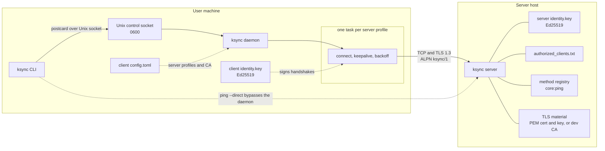
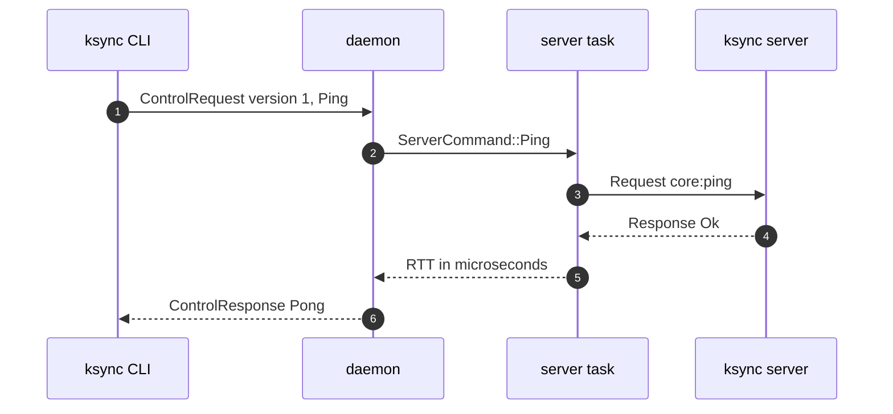

# ksync

ksync is a content-addressed, chunked sync store written in Rust. This branch,
`new-sync`, implements the transport and control foundation for a new protocol:
TLS 1.3 with a mandatory post-quantum key exchange, mutual Ed25519
authentication, a typed method registry, and a per-user daemon.

Storage, chunk transfer, manifests, roots, filesystem sync, and GC are designed
in [ROADMAP.md](ROADMAP.md) but are **not implemented** in this tree yet.

## Status

| Capability | State |
|---|---|
| TLS 1.3, ALPN `ksync/1`, PQ-only `X25519MLKEM768` | Implemented |
| WebPKI server verification plus optional CA file | Implemented |
| Mutual Ed25519 auth bound to the TLS exporter | Implemented |
| Postcard messages over `u32` LE length-prefixed frames | Implemented |
| Uniform method registry with `namespace:name` keys | Implemented |
| `core:ping` | Implemented |
| Server identity plus client allowlist | Implemented |
| Per-user daemon, Unix control socket, keepalive, reconnect | Implemented |
| Chunks, manifests, roots, storage engine, sync, GC | Not implemented |

## At a glance



Normally the CLI does not speak TLS. It asks the daemon over a local Unix
socket. The daemon owns the client identity and keeps one connection task per
configured server. `ksync ping --direct` is the one diagnostic path that
connects without the daemon.

## One request through the daemon



## Documentation

- [docs/architecture.md](docs/architecture.md) — module map, connection and
  daemon state machines, wire format, method dispatch, trust boundaries, test
  map, and the implemented-versus-planned view.
- [docs/protocol.typ](docs/protocol.typ) — protocol and configuration
  specification. Build the PDF with `./scripts/build-docs.sh`.
- [ROADMAP.md](ROADMAP.md) — storage design and the S0–S6 implementation plan.
- [examples/config/README.md](examples/config/README.md) — local development
  configuration.

## Quick start

```sh
. ./env.sh

# Terminal 1
cargo run -- server

# Terminal 2
cargo run -- ping --direct
```

Or use the daemon:

```sh
cargo run -- daemon
cargo run -- status
cargo run -- ping
```

The development server listens on `127.0.0.1:18443`. Its checked-in identity
seeds are public and only suitable for local development.

## Repository layout

| Path | Purpose |
|---|---|
| `src/proto/` | Wire messages, method names, limits, postcard codec, framing |
| `src/tls.rs` | rustls configuration, PQ-only key exchange, development CA |
| `src/identity.rs` | Ed25519 identities, ids, allowlist loading |
| `src/auth.rs` | Authentication transcript, TLS exporter binding |
| `src/method.rs` | Method trait, limits, atomic registry |
| `src/methods.rs` | Built-in `core` methods (`core:ping`) |
| `src/server.rs` | TLS listener, application handshake, request loop |
| `src/client.rs` | Client TLS and application handshake, typed calls |
| `src/daemon.rs` | Per-user daemon and per-server connection tasks |
| `src/control.rs` | Local control schema and Unix socket helpers |
| `src/config.rs` | Client and server TOML resolution |
| `src/shutdown.rs` | Graceful shutdown signal shared by server and daemon |
| `tests/` | Golden vectors, handshake, MITM relay, daemon lifecycle |

## Checks

```sh
cargo test
cargo clippy --all-targets -- -D warnings
cargo fmt --check
./scripts/build-docs.sh
```
