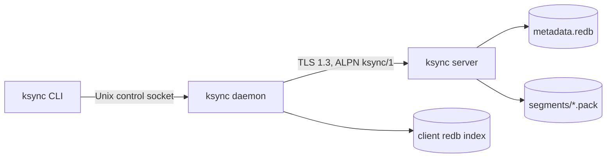

# ksync roadmap

**Status:** storage design settled; implementation not started  
**Branch:** `new-sync`  
**Last updated:** 2026-11-24

ksync is a content-addressed, chunked sync store. It is being rebuilt around a
new wire protocol, a durable server-side chunk store, and a client-side sync
index. This document captures the design decisions and the implementation
sequence.

---

## 1. Current state

### Working

- TLS 1.3 server and client.
- PQ-only key exchange: `X25519MLKEM768`, exactly one group.
- ALPN `ksync/1`, mandatory on both sides.
- WebPKI verification with bundled `webpki-roots` plus an optional CA file.
- Mutual Ed25519 application authentication with TLS exporter channel binding.
- Postcard messages over `u32` little-endian length-prefixed frames.
- Uniform method registry with `namespace:name` keys.
- `core:ping`.
- Server application identity and client allowlist.
- Client daemon with Unix control socket, status/ping, keepalive, reconnect.
- Client and server TOML configuration, development examples, `env.sh`.
- Tracing, graceful shutdown, SIGINT/SIGTERM.
- Golden vectors, MITM relay failure test, daemon integration tests.

### Not implemented

- Storage, chunks, manifests, HLC, sync, GC.
- Any method other than `core:ping`.
- Method discovery.
- Per-method permissions, capability checks, or MAC.
- Plugin loader.
- Streaming, request multiplexing, server push.
- Auth-failure rate limiting.
- Fuzzing harness.

### Repository state

- Branch `new-sync`, working tree clean at the time this roadmap was added.
- Current history includes `c512dcb graceful shutdown, config, protocol docs`.
- The older handoff note in `/tmp/opencode` is stale about uncommitted Phase A
  work; that work is committed.

---

## 2. Target architecture



- **Server:** TLS listener, application identity, method registry, durable
  chunk/manifest/root storage.
- **Daemon:** per-user process; owns the client identity, server connections,
  retry/keepalive, the local sync index, and scan/apply work.
- **CLI:** local control client; talks to the daemon over the Unix socket.

Invariants:

1. No server-assigned ordering is protocol truth; client HLC is.
2. No application data before authentication completes.
3. Auth signatures are bound to the TLS session via the exporter.
4. PQ key exchange is mandatory.
5. Never write `usize` on the wire; schema integers use fixed-width types.
6. No locks held across socket I/O.
7. Segment reads are positioned.
8. Connection slots are released by `Drop`.
9. Private key material is `0600` and never logged.
10. Framing is separate from postcard.

---

## 3. Locked decisions

| Area | Decision |
|---|---|
| Implementation order | S0 → S1 → S2 → S3 → S4 → S5a → S5b → S6; no early redb |
| S0 | `Store` trait plus `MemoryStore`; no wire change |
| Server engine | redb metadata plus append-only segment files |
| Concurrency | Synchronous store core driven by `spawn_blocking`; one writer mutex, never held across `.await` |
| Content hash | BLAKE3 |
| Chunking | FastCDC, min 64 KiB, average 512 KiB, max 8 MiB |
| Transfer | True streaming, record-oriented chunk streams |
| Wire additions | `StreamData`, `StreamEnd`, `StreamAbort`; `Features::STREAMING`; stay on protocol v1 |
| Method API | Buffered `Method`; separate `UploadMethod` and `DownloadMethod` |
| Chunk durability | Committed in bounded batches; no rollback of committed chunks; file atomicity via root CAS |
| Root tree | Recursive Merkle tree |
| Manifest metadata | Metadata lives on directory entries; file manifests stay content-only |
| fs metadata | Content, mode, mtime, and `user.*` xattrs only |
| Ownership | **Not synced in fs roots**; ownership is a target-machine property |
| ACLs / security / trusted xattrs | Not in fs roots; reserved for a separate backup root |
| Client index | Full redb sync index: desired / observed / base / pending, apply journal, cursor |
| Rich records | Generic `records` root kind reserved; fs roots first |

---

## 4. Storage design

### 4.1 Store boundary

Method handlers never touch redb or segment files. They use a `Store` handle
provided through `Context`:

```rust
pub struct Context {
    pub peer: Id,
    pub request_id: RequestId,
    pub store: Arc<dyn Store>,
}

#[async_trait]
pub trait Store: Send + Sync {
    // S0: chunk and object surface
    async fn chunk_has(&self, ids: &[ChunkId]) -> Result<Vec<bool>, StoreError>;
    async fn put_chunks(&self, chunks: Vec<ChunkRecord>) -> Result<PutSummary, StoreError>;
    async fn get_chunk(&self, id: &ChunkId) -> Result<Option<Vec<u8>>, StoreError>;
    async fn object_get(&self, id: &ObjectId) -> Result<Option<Vec<u8>>, StoreError>;
    async fn object_put(&self, bytes: &[u8]) -> Result<ObjectId, StoreError>;

    // S3: local-model surface
    async fn root_get(&self, root: &RootKey) -> Result<Option<RootHead>, StoreError>;
    async fn root_put(&self, update: RootUpdate) -> Result<RootHead, StoreError>;
    async fn root_list(&self) -> Result<Vec<RootHead>, StoreError>;
    async fn history(
        &self,
        root: &RootKey,
        from: u64,
        limit: u32,
    ) -> Result<Vec<RevisionRecord>, StoreError>;
}
```

```rust
pub struct ChunkRecord {
    pub id: ChunkId,
    pub codec: u8,
    pub key_id: u16,
    pub flags: u8,
    pub nonce: [u8; 12],
    pub plain: Vec<u8>,
}
```

`StoreError` maps to `MethodError` with sanitized wire details. Internal paths,
corruption details, and I/O errors stay in server logs.

### 4.2 Server engine

On-disk layout under `data_dir`:

```text
<data_dir>/store/metadata.redb
<data_dir>/store/segments/seg-000001.pack
<data_dir>/store/gc.lock
```

redb tables:

| Table | Key | Value |
|---|---|---|
| `meta` | string | schema version, active segment |
| `chunks` | `ChunkId` | segment id, offset, plain/stored length, codec, flags, key id |
| `segments` | `u32` | committed `valid_len`, state |
| `objects` | `ObjectId` | inline bytes or chunk locator |
| `roots` | `RootKey` | head revision, manifest, HLC, deleted |
| `history` | `(RootKey, u64)` | parent, HLC, author, manifest, deleted |
| `changes` | `u64` | root/revision cursor for incremental sync |

Segment record layout:

```text
hash[32] | codec u8 | flags u8 | key_id u16 | nonce[12]
         | plain_len u32 | stored_len u32 | checksum[16] | payload[stored_len]
```

- Header size: 72 bytes.
- `checksum` is a fast corruption check over the stored payload.
- The authoritative check is recomputing the chunk hash.
- Segment default: 256 MiB. Floor: 128 MiB (16× max chunk).
- Segment names: `seg-%06d.pack`.

Write path:

1. Append chunk records to the active segment.
2. `sync_data()`.
3. One redb transaction updating the chunk index and segment `valid_len`.
4. Commit with `Durability::Immediate`.

Chunk uploads commit in bounded batches (64 MiB or 256 records). An aborted
upload leaves valid committed chunks; they are orphans if no root ever
references them. File atomicity comes from the root CAS, not from rolling back
chunks.

Recovery:

- On open, truncate each active segment to its committed `valid_len`.
- A segment shorter than `valid_len` is corruption and fails startup.
- Rotation creates and fsyncs the new segment file and parent directory before
  the transaction names it active.

Read path:

- Positioned reads only (`pread`/`read_at`).
- Verify the chunk hash before returning bytes.
- Never `seek` plus `read` on a shared cursor.

### 4.3 Streaming transfer

Append three message variants after the reserved `Event` slot:

```text
StreamData  { id: RequestId, body: bytes }          // 8
StreamEnd   { id: RequestId, status: StreamStatus } // 9
StreamAbort { id: RequestId, error: WireError }     // 10
```

`StreamStatus` is `Ok | Error(WireError) | Cancelled`. Variant 7 remains
reserved for `Event`.

Upload flow:

```text
C -> S  Request { id, method, header }
C -> S  StreamData { id, bytes }*
C -> S  StreamEnd { id, Ok | Error | Cancelled }
S -> C  Response { id, Ok(summary) | Error }
```

Download flow:

```text
C -> S  Request { id, method, header }
S -> C  Response { id, Ok(stream_header) | Error }
S -> C  StreamData { id, bytes }*
S -> C  StreamEnd { id, Ok | Error | Cancelled }
```

Rules:

- A stream is bound to one request id. One request remains in flight.
- `StreamEnd` is the only terminal body marker.
- `StreamAbort` is a stop request. The body sender stops and ends with
  `StreamEnd { Cancelled }`.
- `MAX_STREAM_FRAME` is 1 MiB. Bulk transfer is not bounded by the 16 MiB
  envelope.
- Add `Features::STREAMING = 1 << 0`. A client must see it before invoking a
  streaming method. Protocol version remains 1.
- Chunk streams are record-oriented, not raw bytes:
  client-side FastCDC and hashing are preserved, as are manifests and dedup.

Method traits:

```rust
#[async_trait]
pub trait UploadMethod: Send + Sync + 'static {
    const NAME: &'static str;
    type Input: Serialize + DeserializeOwned + Send + 'static;
    type Output: Serialize + DeserializeOwned + Send + 'static;

    async fn call(
        ctx: &mut Context,
        input: Self::Input,
        body: BodyReader,
    ) -> Result<Self::Output, MethodError>;
}

#[async_trait]
pub trait DownloadMethod: Send + Sync + 'static {
    const NAME: &'static str;
    type Input: Serialize + DeserializeOwned + Send + 'static;
    type Output: Serialize + DeserializeOwned + Send + 'static;

    async fn call(
        ctx: &mut Context,
        input: Self::Input,
    ) -> Result<(Self::Output, BodyStream), MethodError>;
}
```

Planned method surface:

| Method | Kind | Body |
|---|---|---|
| `core:ping` | buffered | none |
| `core:chunk-has` | buffered | none |
| `core:chunk-put` | upload | chunk records |
| `core:chunk-get` | download | chunk records |
| `core:manifest-put` | buffered | none |
| `core:manifest-get` | buffered | none |
| `core:root-get` | buffered | none |
| `core:root-put` | buffered | none |
| `core:root-list` | buffered | none |
| `core:history` | buffered | none |
| `core:changes` | buffered | none |

### 4.4 Local model

```rust
pub struct RootKey {
    pub kind: RootKind, // Fs | Records | Backup (later)
    pub name: String,
}

pub struct RootHead {
    pub revision: u64,
    pub manifest: ObjectId,
    pub hlc: Hlc,
    pub deleted: bool,
}

pub struct RevisionRecord {
    pub revision: u64,
    pub parent: Option<u64>,
    pub hlc: Hlc,
    pub author: Id,
    pub manifest: Option<ObjectId>,
    pub deleted: bool,
}

pub struct Hlc {
    pub wall_ms: u64,
    pub counter: u32,
    pub node: [u8; 8],
}
```

- `revision` is an opaque server-assigned CAS token, not ordering truth.
- HLC is stored verbatim; the server never rewrites it.
- `root-put` takes `base: Option<u64>` and fails with `Conflict` if the head
  moved.
- Rollback is a new revision pointing at an older manifest.

Manifests:

```rust
pub struct FileManifest {
    pub version: u16,
    pub total_len: u64,
    pub chunks: Vec<ChunkRef>,
}

pub struct ChunkRef {
    pub id: ChunkId,
    pub plain_len: u32,
}

pub struct DirManifest {
    pub version: u16,
    pub meta: EntryMeta,
    pub entries: Vec<DirEntry>,
}

pub struct DirEntry {
    pub name: Vec<u8>,
    pub meta: EntryMeta,
    pub target: EntryTarget,
}

pub enum EntryTarget {
    File { manifest: ObjectId, size: u64 },
    Dir(ObjectId),
    Symlink(Vec<u8>),
}

pub struct EntryMeta {
    pub mode: u16, // 0o1777: permission bits plus sticky
    pub mtime_ns: i64,
    pub xattrs: Vec<Xattr>, // user.* only in fs roots
}

pub struct Xattr {
    pub name: Vec<u8>,
    pub value: Vec<u8>,
}
```

- Names and xattr values are bytes, not strings.
- Entries and xattrs are sorted for deterministic encoding.
- Name components are at most 255 bytes, with no NUL or `/`.
- Entries are at most 64 xattrs and 64 KiB of xattrs.
- The fs manifest stores exactly the managed metadata.
- Setuid/setgid are excluded from fs roots.
- Large manifests are chunked and referenced by a locator.

### 4.5 Metadata policy

| Metadata | fs sync | Backup root (later) |
|---|---|---|
| Content | yes | yes |
| Mode / permissions | yes | yes |
| Sticky bit | yes | yes |
| Setuid / setgid | no | yes |
| mtime | yes | yes |
| `user.*` xattrs | yes, capped | yes |
| POSIX ACLs | no | yes, with mapping |
| `security.*` / `trusted.*` | no | yes, with mapping |
| `uid` / `gid` | no | yes, with explicit mapping |
| atime / ctime / btime | no | no |
| Hardlinks | no | later |
| Sparse extents | no | later |
| Special files | no | no |

Rationale: numeric uid/gid are machine-local. Applying a remote `uid` can make
files unusable or, worse, hand them to a different local user. First sync does
not apply a remote owner. Files are owned by the daemon user.

Full metadata belongs in a separate backup root with an explicit restore
mapping. Ordinary fs sync stays portable.

### 4.6 Client sync index

The daemon maintains a local redb database with:

| State | Meaning |
|---|---|
| `desired` | what this client wants the root to contain |
| `observed` | the last filesystem scan |
| `base` | the last synced revision/manifest, used for three-way merge |
| `pending` | local operations not yet accepted by the server |
| `cursor` | last server change sequence |

Per-field authority:

| Class | Examples | Filesystem change | Remote change |
|---|---|---|---|
| auto-import | content, mode, mtime, `user.*` | updates `desired` | apply and record |
| explicit-only | records; backup metadata later | ignored until a command | store in `desired` |
| remote-advisory | backup-only namespaces | ignored | store, do not apply |

The merge is `base / desired / remote`, not `filesystem / remote`.

Explicit metadata commands update `desired` and `pending` in one transaction.
The daemon commits `pending` before touching the network or filesystem. Remote
applies use an apply journal so an interrupted apply is not mistaken for a
local edit.

The client database is a sync index and replica, not just a metadata cache. It
does not store bulk file content; the filesystem remains the content store.
The server remains generic for rich records.

### 4.7 GC, retention, encryption

- Retention defaults to unlimited.
- GC is offline, behind an exclusive store lock.
- Mark from retained roots; sweep unreferenced chunks.
- Repack copies live chunks, commits new index entries, then deletes old
  segments. A crash leaves duplicates, never loss.
- redb `compact()` runs after repack.
- History retention is configurable, but GC only runs when requested.
- Encryption is deferred. The record layout reserves `codec`, `key_id`, and
  `nonce`. In v1, codec 0 is identity and key id 0; the server sees plaintext
  and dedups by plaintext BLAKE3.

### 4.8 Configuration (proposed)

```toml
[server]
data_dir = "data"

[store]
segment_bytes = 268435456   # 256 MiB
max_chunk_bytes = 8388608   # 8 MiB
history_max_revisions = 0   # 0 = unlimited
history_max_age_days = 0    # 0 = unlimited

[client]
data_dir = ""               # daemon index; exact default TBD

[client.metadata]
preserve_owner = false
xattrs = "user"             # fs roots
strict_metadata = false
```

Key names and defaults are not final.

---

## 5. Roadmap

| Phase | Goal | Exit criterion |
|---|---|---|
| **S0** | Store boundary and `MemoryStore` | Existing tests and golden vectors unchanged |
| **S1** | Streaming protocol and method traits | Stream state-machine and TLS tests pass; ping unchanged |
| **S2** | Chunk methods over `MemoryStore` | Upload, download, dedup, caps, and abort tests pass |
| **S3** | Manifests, roots, history, changes | Deterministic manifests; create, update, rollback, conflict tests pass |
| **S4** | redb and segment engine | Conformance suite passes on redb; crash and recovery tests pass |
| **S5a** | Client sync index and fs sync | Two clients converge; interrupted apply resumes; disk chown does not loop |
| **S5b** | `records` root kind | Records sync through the same object/root machinery |
| **S6** | GC, repack, protocol freeze | Reachable data preserved; unreachable data reclaimed; compatibility vectors added |

### S0 — Store boundary

Deliverables:

- `src/store/` modules: `mod.rs`, `hlc.rs`, `chunk.rs`, `memory.rs`.
- `Store`, `StoreError`, `ChunkId`, `ObjectId`, `ChunkRecord`, `PutSummary`.
- HLC type, ordering, and clock.
- BLAKE3 verification and FastCDC wrapper.
- `MemoryStore` with short critical sections.
- `Context` gains `Arc<dyn Store>`; `Server` owns the handle.
- No new wire messages and no new `core:*` methods.

Definition of done:

- `cargo test`, `cargo clippy --all-targets -- -D warnings`, `cargo fmt --check`.
- `tests/golden.rs` unchanged.
- `core:ping` integration still passes.
- MemoryStore tests cover dedup, wrong hash, oversize, empty chunk, and object
  round-trip.

### S1 — Streaming protocol

Deliverables:

- `StreamData`, `StreamEnd`, `StreamAbort` message variants.
- `StreamStatus`, `Features::STREAMING`, `MAX_STREAM_FRAME`.
- `BodyReader`, `BodyStream`, `UploadMethod`, `DownloadMethod`.
- Registry modes and erased dispatch.
- Server request-loop pump for upload and download.
- Client `call_upload` and `call_download`.
- Golden vectors and protocol documentation.
- Test-only stream methods for transport tests.

Definition of done:

- Normal end, early abort from either side, wrong id, data after end, and
  frame-size enforcement are tested.
- A buffered request during a stream is a protocol error.
- `core:ping` bytes and behaviour are unchanged.

### S2 — Chunk transfer

Deliverables:

- `core:chunk-has`, `core:chunk-put`, `core:chunk-get`.
- Fixed-width chunk record parser and encoder.
- Bounded batching and per-request caps.
- Dedup and idempotent puts.
- Chunk hash verification.
- Missing chunks skipped on get; client computes the missing set.

Definition of done:

- Upload, download, dedup, oversize, wrong hash, and abort tests pass.
- A multi-hundred-MiB transfer works over TLS without buffering the whole file.
- Bounded memory and backpressure are demonstrated.

### S3 — Manifests, roots, history

Deliverables:

- `FileManifest`, `DirManifest`, `EntryMeta`, `EntryTarget`, `ChunkRef`.
- Deterministic encoding and versioning.
- `core:manifest-put/get`, `core:root-get/put/list`, `core:history`,
  `core:changes`.
- HLC handling and server-assigned revisions.
- Root CAS, tombstones, and rollback.
- Manifest validation for GC structure.

Definition of done:

- Manifest golden vector is stable.
- Create, update, rollback, tombstone, and conflict tests pass.
- Disk chown is not a local change in the model (owner is not in fs metadata).
- GC can traverse a tree and enumerate chunk references.

### S4 — Durable engine

Deliverables:

- `RedbStore` implementing the same `Store` trait.
- Segment append, rotation, `valid_len`, and recovery.
- Positioned reads and hash verification.
- Single writer mutex inside `spawn_blocking`.
- Same conformance suite as `MemoryStore`.
- Crash tests for truncation, missing segments, and bad checksums.

Definition of done:

- S2/S3 conformance tests pass on redb.
- Restart recovers committed chunks and roots.
- A truncated active segment is recovered; a short sealed segment fails
  startup.
- Dedup works across restarts.

### S5a — Client sync index

Deliverables:

- Client redb schema: `meta`, `roots`, `files`, `records`, `base`, `desired`,
  `observed`, `pending`, `apply_journal`, `cursor`.
- Filesystem scan and content hashing.
- Three-way merge: `base / desired / remote`.
- Apply journal and crash recovery.
- Explicit metadata commands (`meta get/set/import`).
- Real `sync` control command.
- fs root sync over the streaming methods.

Definition of done:

- Two clients converge on a test tree.
- Interrupted apply resumes without creating a false local change.
- A local `chown` does not produce a revision or a loop.
- `user.*` xattrs and mode changes sync; ACLs and owner do not.
- Client database permissions are `0600`.

### S5b — Records

Deliverables:

- `RootKind::Records`.
- A content-addressed record object and a root manifest listing record ids.
- Client `records` table and indexing.
- A first schema (for example contacts).
- Conflict policy for records.

Definition of done:

- Records sync through the same object/root machinery.
- The server does not interpret record fields.
- GC follows record references.

### S6 — GC, retention, freeze

Deliverables:

- Offline GC command behind an exclusive lock.
- Mark and sweep from retained roots.
- Repack live chunks and delete old segments.
- Configurable history retention.
- redb compaction.
- Golden vectors for every method payload.
- Protocol compatibility tests.
- `docs/protocol.typ` and storage documentation updated.

Definition of done:

- Unreachable chunks are reclaimed.
- Reachable data is preserved.
- A crash during repack leaves duplicates, never loss.
- Protocol v1 is frozen with compatibility vectors.

---

## 6. Testing strategy

- **Unit:** HLC ordering and overflow, chunk record parsing, manifest
  determinism, metadata encoding, caps.
- **Golden:** every message variant, authentication transcript, and method
  payload that is stable.
- **Streaming:** duplex and TLS tests for normal end, abort, wrong id,
  data-after-end, frame limits, and backpressure.
- **Store conformance:** one suite run against `MemoryStore` and `RedbStore`.
- **Crash and recovery:** truncated active segment, missing segment, bad
  checksum, restart, interrupted batch.
- **Client:** metadata authority, explicit changes, apply resume, ownership
  non-sync, xattr policy.
- **GC:** mark/sweep correctness, repack crash safety, retention.
- **Integration:** MITM relay, daemon lifecycle, reconnect, real sync between
  two clients.

CI commands:

```sh
cargo test
cargo clippy --all-targets -- -D warnings
cargo fmt --check
./scripts/build-docs.sh
```

---

## 7. Open decisions

- Final `RootKey` identity: `kind + user-facing name` versus a random id with a
  name mapping.
- Whether fs `mode` includes sticky (`0o1777`) as proposed.
- Manifest encoding: versioned postcard versus a custom fixed-width format.
- fs content conflict policy: CAS conflict then pull; path-level conflict
  copies for v1.
- Client data directory default: `$XDG_DATA_HOME/ksync` versus config-relative.
- Exact configuration key names and defaults.
- Backup-root owner mapping format and unknown-user policy.
- `records` schema and conflict semantics.
- Authorization model beyond the v1 allowlist.
- Encryption and the dedup/encryption model.
- Exact protocol freeze point.

---

## 8. Deferred and non-goals

- Encryption at rest.
- Per-root authorization, capability checks, and MAC.
- Plugin loader.
- Request multiplexing.
- Server push (`Event` remains reserved).
- Auth-failure rate limiting.
- Fuzzing harness.
- Hardlink preservation.
- Sparse-file extents.
- Device nodes, sockets, and FIFOs.
- Windows and macOS-specific metadata.
- Online GC.
- Automatic backup/restore beyond the fs sync path.

---

## 9. Commands

```sh
cargo test
cargo clippy --all-targets -- -D warnings
cargo fmt --check
./scripts/build-docs.sh
```

Development run:

```sh
. ./env.sh
cargo run -- server
cargo run -- ping --direct
cargo run -- daemon
cargo run -- status
cargo run -- ping
```

---

## 10. References

```text
docs/protocol.typ      protocol and configuration document
src/proto/mod.rs       messages, names, limits, encode/decode
src/proto/frame.rs     u32 LE framing
src/auth.rs            transcript, exporter, Ed25519
src/identity.rs        keys, ids, allowlists
src/method.rs          Method trait, MethodList, Registry
src/methods.rs         core:ping
src/server.rs          TLS, auth, request loop
src/client.rs          connect, handshake, call
src/config.rs          client/server TOML
src/control.rs         daemon control protocol
src/daemon.rs          connection tasks, keepalive, reconnect
src/shutdown.rs        SIGINT/SIGTERM watch
tests/golden.rs        wire vectors
tests/mitm.rs          relay auth failure
tests/daemon.rs        lifecycle/reconnect
```
