# Architecture

This document describes the code that exists on the `new-sync` branch today.
The storage and sync design in [ROADMAP.md](../ROADMAP.md) is shown only in the
final [implemented versus planned](#10-implemented-versus-planned) section and
is clearly marked as future work.

The flow and state diagrams are Mermaid, so GitHub renders them directly from
this file. The wire frame is shown as an ASCII code block.

## Contents

1. [Processes and trust boundaries](#1-processes-and-trust-boundaries)
2. [Code map](#2-code-map)
3. [Handshake and authentication](#3-handshake-and-authentication)
4. [Server runtime](#4-server-runtime)
5. [Daemon runtime](#5-daemon-runtime)
6. [Wire format](#6-wire-format)
7. [Method layer](#7-method-layer)
8. [Configuration and identity](#8-configuration-and-identity)
9. [Tests](#9-tests)
10. [Implemented versus planned](#10-implemented-versus-planned)
11. [Limits and timeouts](#11-limits-and-timeouts)

## 1. Processes and trust boundaries

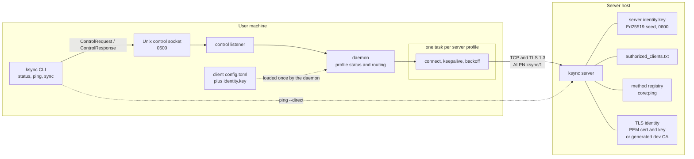

There are three roles:

| Role | Responsibility |
|---|---|
| **CLI** | Parses commands, loads the client config, and either talks to the daemon over the control socket or, for `ping --direct`, runs the client handshake itself. It never owns a long-lived network connection otherwise. |
| **Daemon** | One process per user. Owns the client identity, binds the control socket, runs one connection task per configured server, and maintains connection status. |
| **Server** | Listens on TCP, terminates TLS 1.3, authenticates clients by Ed25519 identity and allowlist, and dispatches authenticated method calls. |

Trust is split into two independent planes:

- **TLS** proves _which server host_ was reached and protects the channel.
- **Ed25519 application auth** proves _which user/device_ is on the other end.

Neither depends on the other's certificate being pinned. The TLS exporter binds
the two planes together for the lifetime of the connection.

## 2. Code map

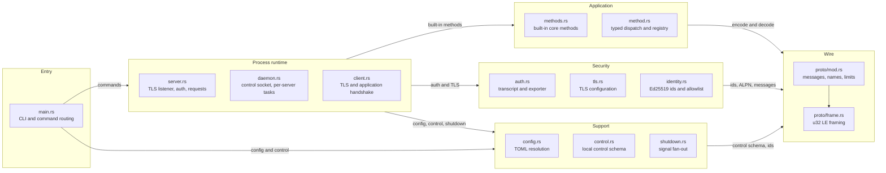

The layer map shows the primary dependency direction. The table below records
each module's actual imports.

`lib.rs` exposes these modules as a library so the integration tests can drive
the real listener and daemon in-process.

| Module | Responsibility | Key dependencies |
|---|---|---|
| `main.rs` | clap command parsing, tracing setup, command routing | `server`, `daemon`, `client`, `control`, `config`, `methods`, `proto` |
| `lib.rs` | Library exports for tests | all modules |
| `proto/mod.rs` | Message schema, method names, error codes, features, limits, postcard codec, version negotiation | `proto::frame` |
| `proto/frame.rs` | `u32` LE length-prefixed frames, bounded allocation, 16 MiB maximum | none |
| `tls.rs` | rustls provider, TLS 1.3-only configs, PQ-only key exchange, development CA and leaf | `proto` |
| `identity.rs` | Ed25519 seeds, identity ids, signature helpers, allowlist parsing, `0600` key files | `proto` |
| `auth.rs` | Authentication transcript, TLS exporter, role-bound sign and verify | `identity`, `proto` |
| `method.rs` | `Method` and erased dispatch, per-method limits, `MethodList`, atomic `Registry` | `proto` |
| `methods.rs` | Built-in core methods and the core registry | `method`, `proto` |
| `server.rs` | Listener, connection limit, per-connection handshake and request loop | `auth`, `config`, `identity`, `method`, `methods`, `proto`, `shutdown`, `tls` |
| `client.rs` | TCP/TLS connect, application handshake, typed request helper | `auth`, `config`, `identity`, `method`, `proto`, `tls` |
| `daemon.rs` | Control listener, per-server tasks, status, keepalive, reconnect | `client`, `config`, `control`, `identity`, `methods`, `proto`, `shutdown` |
| `control.rs` | Local control schema, framing, request helper, stale socket handling | `proto` |
| `config.rs` | Client and server TOML discovery, path resolution, CLI overrides | `identity`, `proto` |
| `shutdown.rs` | `watch`-based shutdown signal, SIGINT/SIGTERM installation | none |

## 3. Handshake and authentication

### 3.1 Connection sequence

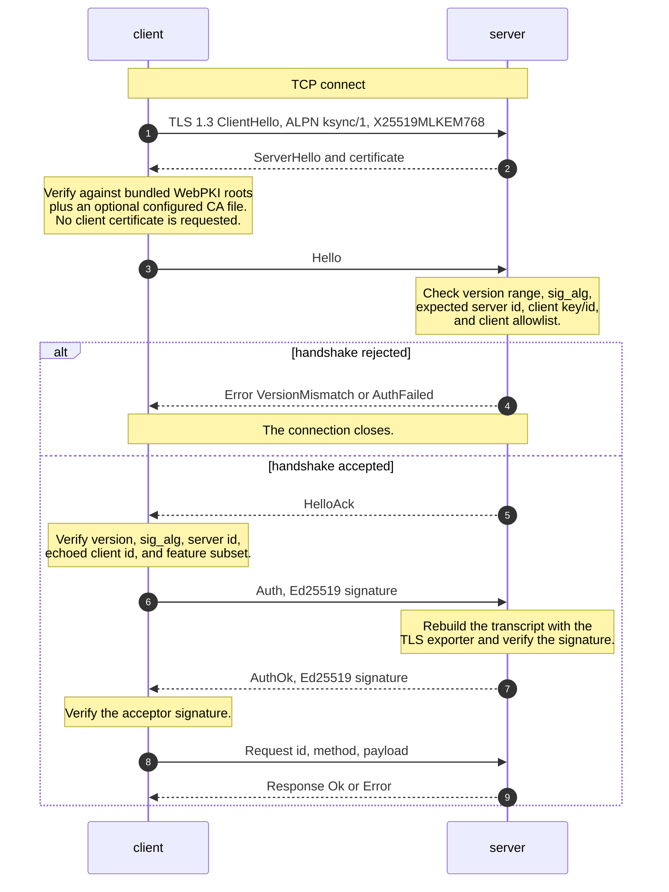

The server sends `HelloAck` only after it has accepted the client's version,
signature algorithm, server id, key/id pair, and allowlist entry. Failures in
the last three cases deliberately produce the same `AuthFailed` with an empty
detail, so an unauthenticated peer cannot enumerate identities.

`Hello` carries a version range and `HelloAck` selects one version. The current
build supports exactly version `1`. Features are negotiated by intersection.
The client currently offers `Features::NONE` and the server's known set is
empty, so the selected feature mask is always `0`.

### 3.2 What each authentication layer proves

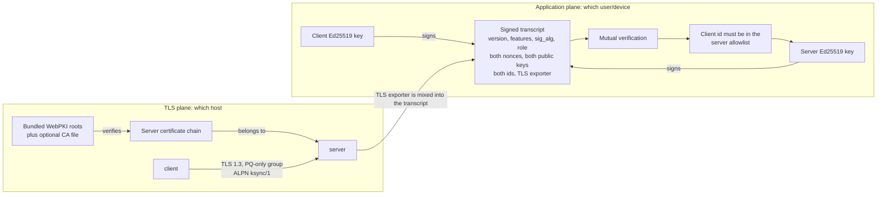

The exported channel binding is:

| Field | Value |
|---|---|
| Label | `EXPORTER-ksync-auth-v1` |
| Context | Selected protocol version as `u16` big-endian |
| Length | 32 bytes |

Application identity ids are derived, not configured:

```text
id = SHA-256("ksync-id-v1" || sig_alg || public_key)
```

The transcript is independent of postcard and contains, in order:
`"AUTH-ksync-v1"`, selected version, feature mask, signature algorithm, role
byte (`0x01` initiator, `0x02` acceptor), length-prefixed initiator nonce,
acceptor nonce, initiator public key, acceptor public key, initiator id,
acceptor id, and exporter. Each side signs with its own role. A signature
cannot be reflected in the other direction because the role byte is signed.

### 3.3 Why a relay cannot reuse a signature

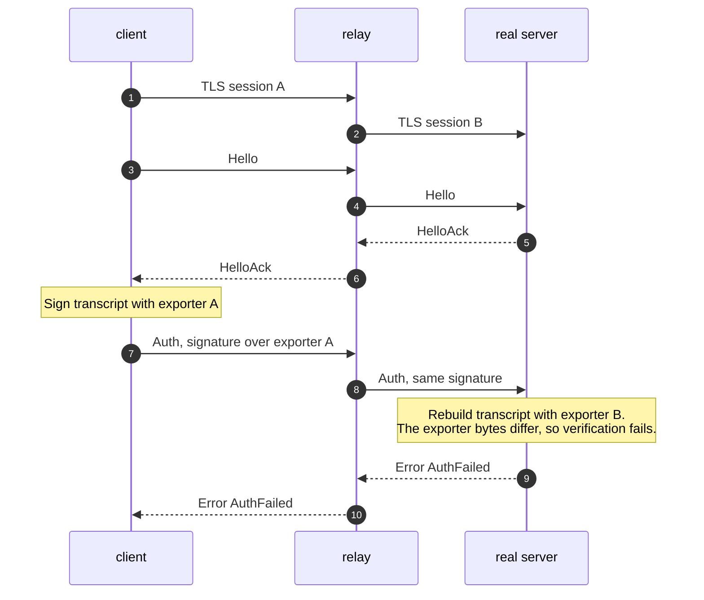

The relay test in `tests/mitm.rs` terminates two separate TLS sessions and
forwards application frames verbatim. The signatures are valid in isolation,
but the exporter differs between sessions, so the server rejects the relayed
`Auth`.

## 4. Server runtime

### 4.1 Accept loop and connection limiting

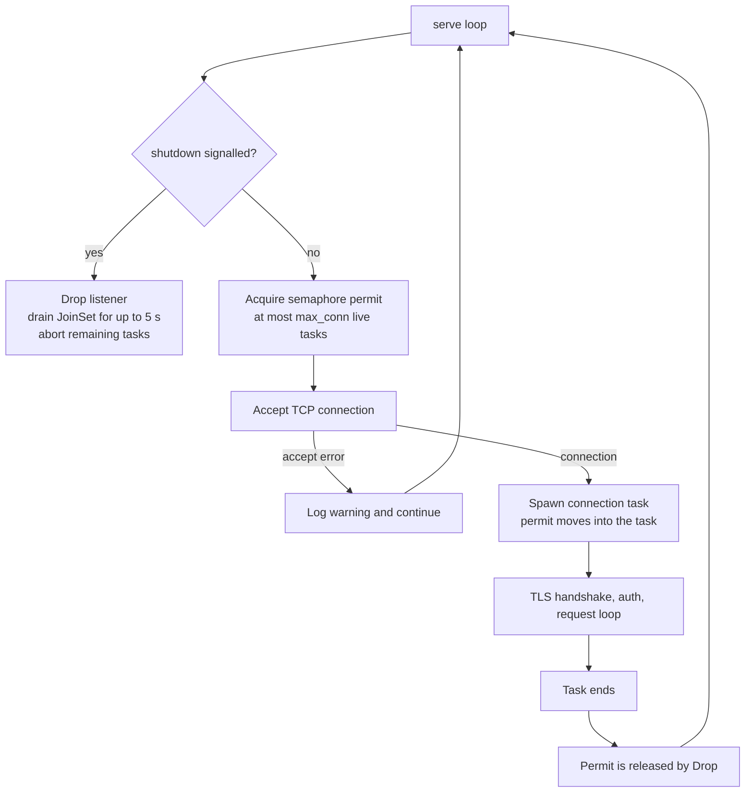

The permit is acquired **before** `accept`. At capacity the process stops
pulling connections from the kernel queue, so the backlog absorbs the burst
instead of the process holding sockets it cannot serve. `max_conn` defaults to
128 and is clamped to at least one at startup. A failed `accept` is logged and
does not bring down the listener.

Shutdown is a single `watch` event. The server stops accepting, gives live
connections five seconds to finish, aborts whatever remains, and waits up to
one more second for the aborted tasks.

### 4.2 Connection state machine

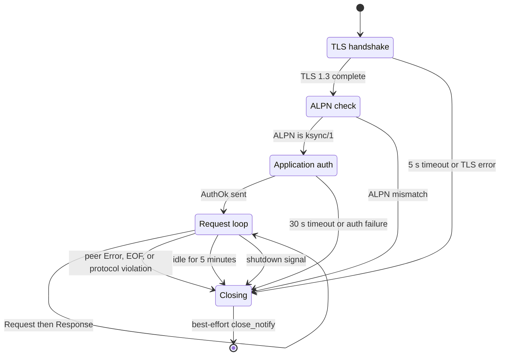

The TLS handshake must complete within five seconds. The whole application
handshake from `Hello` through `AuthOk` gets thirty seconds. An authenticated
connection may sit idle for five minutes. Before closing normally the server
makes a best-effort TLS `close_notify`; a clean peer EOF is treated as ordinary
disconnect, not as an error.

### 4.3 Request loop

The loop is deliberately sequential:

1. Read one framed message with a 16 MiB limit.
2. If it is a `Request`, dispatch it through the registry and write one
   `Response`.
3. If it is a terminal `Error`, log and close.
4. Any other message is a protocol violation: send `Error(Protocol)` and close.
5. Clean EOF, idle timeout, or shutdown ends the loop.

Version 1 permits one request in flight per connection. There is no
multiplexing, server push, or interleaved stream. `request.id` is echoed by the
server, and each request is logged with its method and elapsed time.

## 5. Daemon runtime

### 5.1 Components

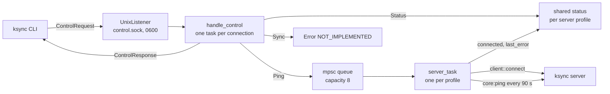

The daemon loads the client identity once and shares it across server tasks.
Each task owns its TLS connection and processes commands one at a time. The
control plane never sees identities or TLS settings; it only names a configured
server profile.

The control socket is `0600`. A directory created by the daemon is `0700`; an
existing shared directory is never chmodded. On startup, a stale socket is
removed only when connecting to it fails with `NotFound` or
`ConnectionRefused`. If a live daemon answers, startup fails instead of
stealing the socket.

### 5.2 Per-server task state machine

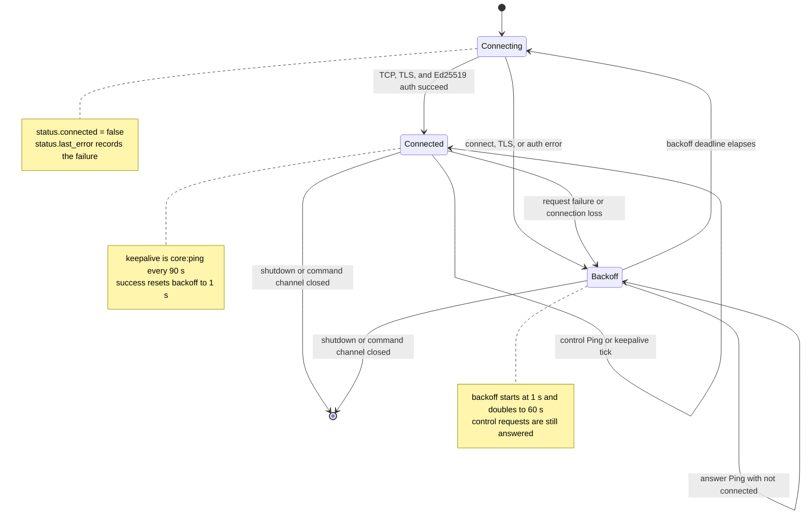

While connected, the task selects between three events: shutdown, a queued
control command, and the keepalive tick. A `Ping` is a real `core:ping` request
over the existing TLS connection; its round-trip time is returned to the CLI.
A request failure marks the profile disconnected and drops into backoff. A
keepalive failure does the same.

While backing off, the task continues to receive control commands so a CLI does
not hang until its own timeout. A ping gets an immediate `not connected` error.
On the next successful connection, the backoff resets to one second.

### 5.3 Control protocol

The control protocol uses the same framing and postcard codec as the network
protocol, but a separate schema and version. One request and one response are
exchanged per Unix socket connection.

| Command | Result | Current behavior |
|---|---|---|
| `Status` | `DaemonStatus { pid, servers }` | Returns the daemon pid and each profile's `connected` and `last_error` |
| `Ping { server }` | `Pong { server, rtt_micros }` | Sends `core:ping` through the selected server task |
| `Sync { server }` | `Error` | Always returns control code `NOT_IMPLEMENTED` (4) |

| Control code | Meaning |
|---|---|
| `0` | Bad version |
| `1` | Unknown server |
| `2` | Not connected |
| `3` | Timeout |
| `4` | Not implemented |
| `5` | Internal |

When several profiles are configured, a ping without a server name is
rejected rather than guessed. `Status` needs no profile; `Sync` currently
returns `NOT_IMPLEMENTED` before it selects one.

### 5.4 CLI routing

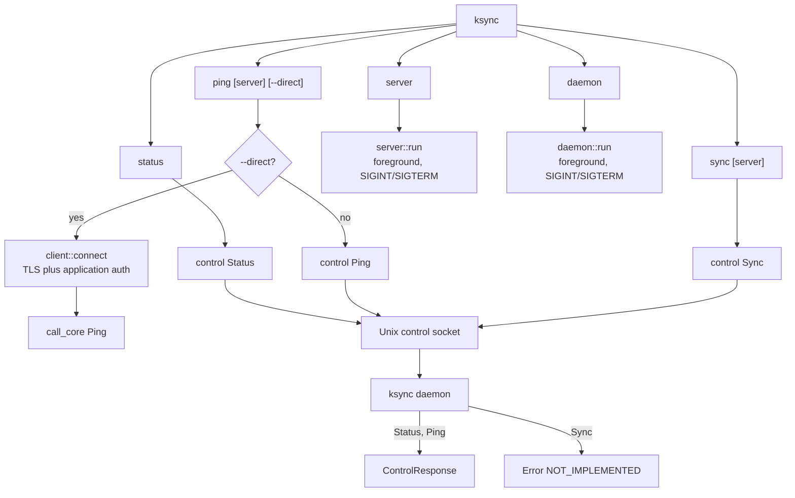

The CLI config path is global: `--client-config`, then
`KSYNC_CLIENT_CONFIG`, then the XDG default. `server` and `daemon` run in the
foreground and rely on the shared signal handler for graceful shutdown.

## 6. Wire format

Every frame is a length prefix followed by exactly that many bytes of postcard:

```text
+-----------------------------+------------------------------------------+
| u32 LE body length (4 B)    | postcard-encoded Message (body length B) |
+-----------------------------+------------------------------------------+
```

Rules enforced by `src/proto/frame.rs` and `src/proto/mod.rs`:

- The length counts the postcard body only, not the four-byte prefix.
- A zero-length frame is invalid.
- The body limit is 16 MiB, checked before allocation.
- The decoder must consume the whole body; trailing bytes are an error.
- Framing is owned by ksync, not by postcard, so it can change independently
  of the schema.
- No `usize` is written to the wire. Schema integers are fixed-width.

The message schema is append-only. The postcard variant index is the wire tag:

| Index | Variant | Direction |
|---|---|---|
| `0` | `Hello` | initiator to acceptor |
| `1` | `HelloAck` | acceptor to initiator |
| `2` | `Auth` | initiator to acceptor |
| `3` | `AuthOk` | acceptor to initiator |
| `4` | `Request` | client to server in version 1 |
| `5` | `Response` | server to client in version 1 |
| `6` | `Error` | either direction, terminal |
| `7` | reserved | future `Event`; not used |

Message-specific limits are lower than the frame limit where appropriate:

| Message | Limit |
|---|---|
| `Hello`, `HelloAck` | 4 KiB |
| `Auth`, `AuthOk` | 8 KiB |
| `Error` detail | 1 KiB |
| Other messages | 16 MiB frame limit |

`Message::Error` is terminal and closes the connection. `ResponseBody::Error`
is a per-request failure and does not close it. Error codes are append-only
numeric values (`0` through `11` currently). An unknown code is preserved as
`ErrorCode::Unknown`.

## 7. Method layer

### 7.1 Dispatch pipeline

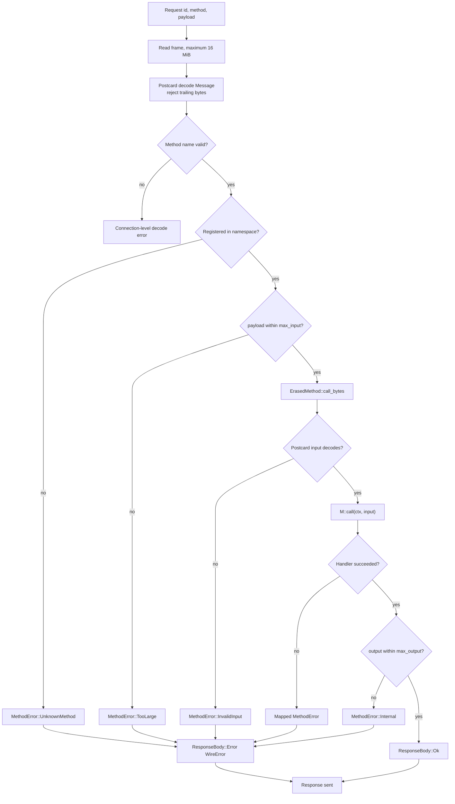

A malformed message envelope or invalid method name fails during `Message`
decoding and is a connection-level error. Failures after a valid request
envelope is dispatched are reported per request, so the connection can
continue.

`Context` currently carries only the authenticated `peer` identity and the
`request_id`. The planned `Store` handle is not present yet.

### 7.2 Method errors

| `MethodError` | Wire code |
|---|---|
| `InvalidInput` | `InvalidRequest` |
| `NotFound` | `NotFound` |
| `Conflict` | `Conflict` |
| `TooLarge` | `TooLarge` |
| `UnknownMethod` | `UnknownRequest` |
| `Internal` | `Internal` |

Detail text is truncated to 1 KiB. Handlers must not put keys, filesystem
paths, or internal stack details into it. In the current build the only
built-in method is `core:ping`, which takes postcard unit input and output
(both zero bytes).

### 7.3 Registration

`MethodList` stages handlers by local name. `Registry::register_all` validates
every name and inserts the whole namespace atomically: an invalid or duplicate
name leaves the registry unchanged. `Registry::register_plugin` rejects the
reserved namespaces `core`, `sys`, and `admin`. There is no plugin loader in
this tree; the registration API exists, but only the core registry is built at
startup.

## 8. Configuration and identity

### 8.1 Client and server resolution

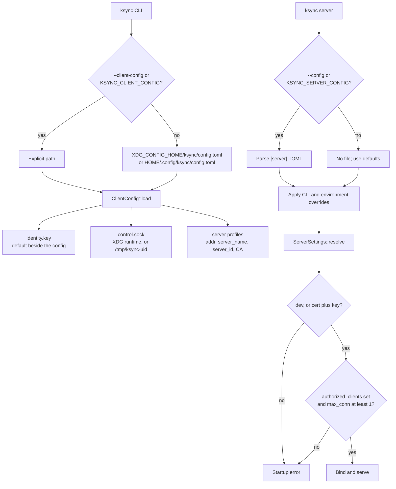

Client paths in TOML resolve relative to the config file, with the sole
exception that an omitted control socket uses the XDG runtime default. Server
CLI paths resolve relative to the invoking directory; server TOML paths
resolve relative to the TOML file. Precedence for the server is CLI and
environment over TOML over defaults.

Key defaults:

| Setting | Default |
|---|---|
| Server listen address | `127.0.0.1:8443` |
| Server data directory | `data` |
| Server identity key | `<data_dir>/identity.key` |
| Server maximum connections | `128` |
| Server client allowlist | Required; no default |
| Server TLS | Required `tls_cert` and `tls_key`, unless `dev = true` |
| Client identity | `identity.key` beside the client config |
| Client control socket | `$XDG_RUNTIME_DIR/ksync/control.sock`, else `/tmp/ksync-<uid>/control.sock` |
| Client servers | At least one; names must be unique |

`dev = true` generates a local CA and a `localhost` leaf under
`<data_dir>/tls/`. It cannot be combined with explicit TLS material. The CA is
a trust anchor for the client, not a certificate pin, so the leaf can rotate.
Half-written dev TLS material is rejected rather than silently regenerated.

### 8.2 Identity material

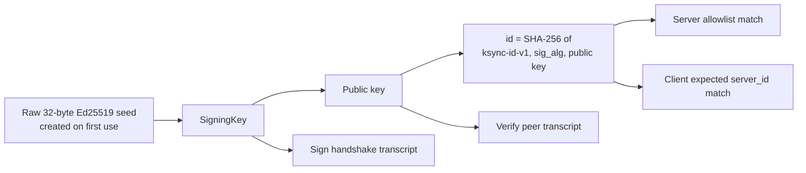

Identity files contain a raw 32-byte seed, are written with mode `0600`, and
are never logged. Reading tightens an existing file's permissions. A malformed
file is an error; it is not replaced. The checked-in development seeds under
`examples/config/` are public on purpose and must not be used outside local
development.

## 9. Tests

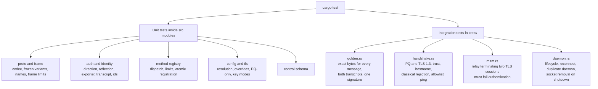

The integration tests use the real `server::serve` loop and real rustls
connections. TLS verification is never disabled: tests add the development CA
as a trust anchor. A classical-only client is expected to fail rather than
downgrade. The daemon tests drive `daemon::run_until` with a test shutdown
channel, so they exercise the real control loop without signals.

## 10. Implemented versus planned

The following diagram is **not current behavior**. It maps the design in
[ROADMAP.md](../ROADMAP.md) onto the current foundation so the intended shape is
visible.

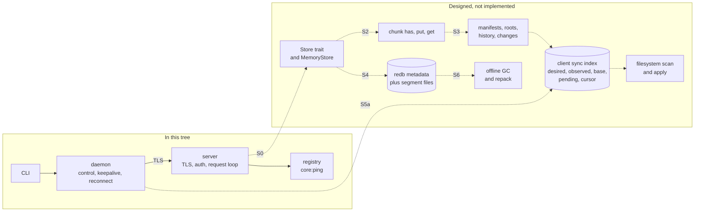

| Area | Current tree | Planned |
|---|---|---|
| Store boundary | None | `Store` trait plus `MemoryStore` |
| Chunk transfer | None | `core:chunk-has`, `core:chunk-put`, `core:chunk-get` with streaming |
| Wire streaming | None | `StreamData`, `StreamEnd`, `StreamAbort`; `Features::STREAMING` |
| Manifests | None | File and directory manifests, deterministic encoding |
| Roots and history | None | Root CAS, revisions, HLC, tombstones, rollback |
| Server storage | None | redb metadata plus append-only segment files |
| Client sync index | None | redb desired/observed/base/pending/apply journal/cursor |
| Filesystem sync | None | Scan, three-way merge, apply journal |
| Records roots | None | Generic content-addressed records |
| GC | None | Offline mark/sweep, repack, compaction |

## 11. Limits and timeouts

| Item | Value |
|---|---|
| Maximum TLS frame body | 16 MiB |
| `Hello` / `HelloAck` message limit | 4 KiB |
| `Auth` / `AuthOk` message limit | 8 KiB |
| `Error` detail limit | 1 KiB |
| Default method input and output limit | 16 MiB |
| Server TLS handshake timeout | 5 s |
| Client TCP connect timeout | 10 s |
| Client TLS handshake timeout | 10 s |
| Application auth timeout | 30 s both sides |
| Authenticated idle timeout | 5 min |
| Default maximum connections | 128, at least 1 |
| Graceful shutdown drain | 5 s, then abort and wait 1 s |
| Daemon keepalive interval | 90 s |
| Daemon reconnect backoff | 1 s doubling to 60 s |
| Daemon control command timeout | 45 s |
| Requests in flight per connection | 1 |
| Control protocol version | 1 |

For the full wire contract, see [protocol.typ](protocol.typ).
